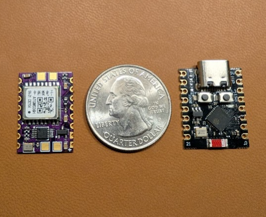
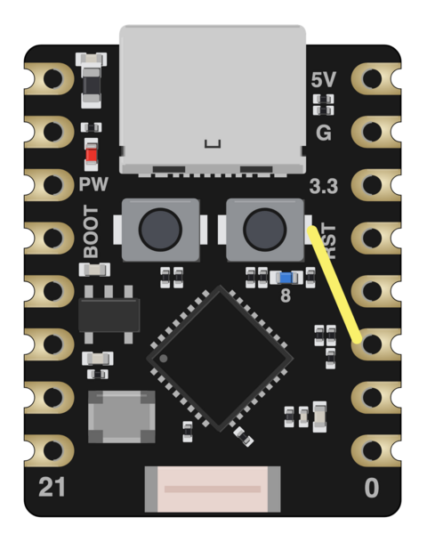
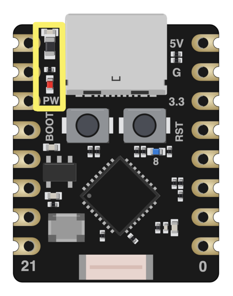
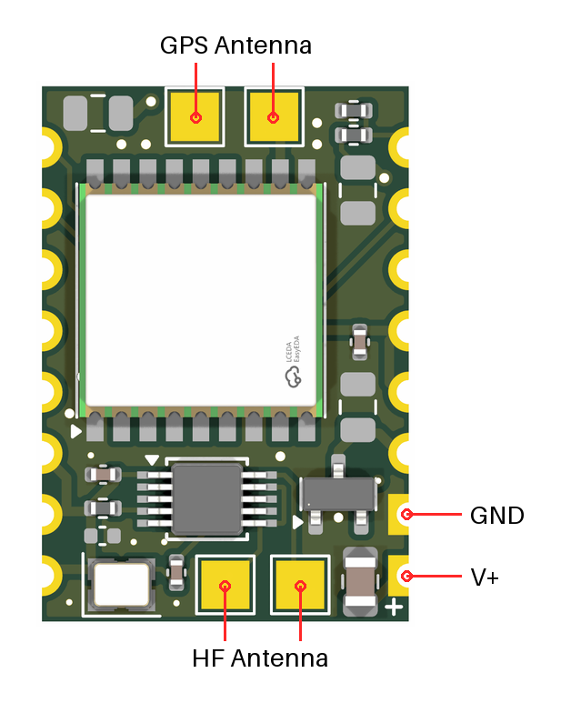
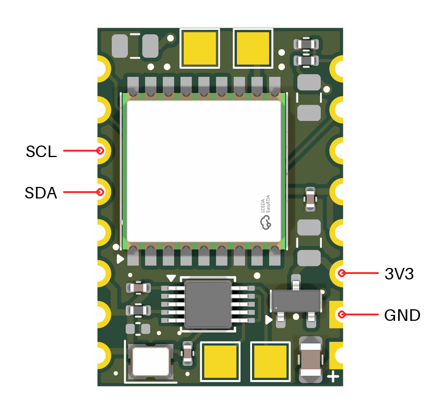

# Vagabond1 WSPR Transmitter



Vagabond1 is a tiny WSPR transmitter that piggybacks on the popular
[ESP32 C3 Super Mini board](https://www.espboards.dev/esp32/esp32-c3-super-mini).
It contains only 11 components (including 7 passives).
Vagabond1 is fully supported by
[Nomad](https://github.com/wsprtv/nomad) firmware.

## Links

- [Schematic](https://wsprtv.com/vagabond1/docs/vagabond1.pdf)
- [Interactive BOM](https://wsprtv.com/vagabond1/docs/ibom.html)
- [KiCad Files](https://github.com/wsprtv/vagabond1/tree/main/kicad)
- [JLCPCB Fabrication Files](https://github.com/wsprtv/vagabond1/tree/main/fabrication)
- [Nomad Firmware](https://github.com/wsprtv/nomad)
- [ESP32 C3 Super Mini Documentation](https://www.espboards.dev/esp32/esp32-c3-super-mini/)
- [Power Measurements](#power-measurements)

## Assembly

Vagabond1 boards can be assembled at JLCPCB using
[these fabrication files](https://https://github.com/wsprtv/vagabond1/tree/main/fabrication).
An [alternative BOM](https://github.com/wsprtv/vagabond1/tree/main/fabrication/options/jlcpcb_bom_si5351a.csv)
is provided replacing MS5351m with Si5351a. While
the two parts have nearly identical performance, Si5351a consumes
[less power](#power-measurements).

Select 0.8mm board thickness.

When soldering Vagabond1 and ESP32 C3 Super Mini boards together, orient them
so that the GPS module is away from the USB-C port.

The recommended GPS antenna is a magnetic wire (~30AWG) dipole with
a ~30mm twisted feedline and ~46mm legs.

## ESP32 C3 Super Mini Modifications

The ESP32 board needs two modifications when powered with solar cells.

1. The RESET line on the ESP32 needs to be routed to pin 2 to enable voltage
monitoring. Connect the two pads with a wire as shown below:



2. [Optional] Replace the reverse polarity protection diode on VSYS with a 0-ohm
resistor or a short wire to eliminate an unnecessary 0.2V drop. Also,
consider removing the always-on power LED or the associated current-limiting
resistor (or both) to save ~0.3 mA. The image below shows the location
of the diode (top highlighted component), followed by the resistor
and the LED.



## Power / Antenna Connections



## Sensor Connections



Your I2C sensor should have a 4.7k or 10k pullup resistor on SCL.
A pullup resistor on SDA is optional. In Nomad CT handlers,
initialize I2C as follows:

```
from machine import I2C, Pin
i2c = I2C(0, scl = Pin(10), sda = Pin(9), freq = 100000)
```

For 1-Wire protocols (such as DS18B20 temperature sensors), use pin
8 for the data line. This pin is shared with the blue LED,
so disable the LED in settings to avoid interference. More than one
sensor may be attached to the same data line, and no pullup
resistor is needed.

## Power Measurements ##

All mesurements were performed with a 3.6V power supply.

50 ohm levels were measured with a tinySA Ultra+ spectrum analyzer and may have up to
[2 dB of absolute error](https://tinysa.org/wiki/pmwiki.php?n=TinySA4.Specification).
75 ohm levels were derived from peak-to-peak voltages measured across a 75 ohm resistor
with a high-bandwidth oscilloscope.

### General ###

| State                         | Current (mA) |
| ----------------------------- | ------------ |
| Idle, enable_lp_sleep = False | 7            |
| Idle, enable_lp_sleep = True  | 0.3          |
| GPS Acquisition               | 30-32        | 
| Red LED On                    | 0.3          |
| Blue LED On                   | 0.5          |

### MS5351m TX, 50 Ohm

| Nomad TX Power   | Current (mA) | Output Power (dBm) |
| ---------------- | ------------ | ------------------ |
| Low (LP)         | 47           | 5.3                |
| Medium (MP)      | 52           | 9.0                |
| High (HP)        | 65           | 13.7               |
| Ultra-High (UHP) | 69           | 15.4               |

### Si5351a TX, 50 Ohm

| Nomad TX Power   | Current (mA) | Output Power (dBm) |
| ---------------- | ------------ | ------------------ |
| Low (LP)         | 32           | 4.4                |
| Medium (MP)      | 39           | 8.9                |
| High (HP)        | 53           | 14.2               |
| Ultra-High (UHP) | 55           | 15.3               |

### MS5351m TX, 75 Ohm

| Nomad TX Power   | Current (mA) | Output Power (dBm) |
| ---------------- | ------------ | ------------------ |
| Low (LP)         | 46           | 5.0                |
| Medium (MP)      | 50           | 7.9                |
| High (HP)        | 63           | 12.2               |
| Ultra-High (UHP) | 66           | 13.7               |

### Si5351a TX, 75 Ohm

| Nomad TX Power   | Current (mA) | Output Power (dBm) |
| ---------------- | ------------ | ------------------ |
| Low (LP)         | 32           | 4.0                |
| Medium (MP)      | 38           | 8.3                |
| High (HP)        | 51           | 13.0               |
| Ultra-High (UHP) | 53           | 13.9               |
