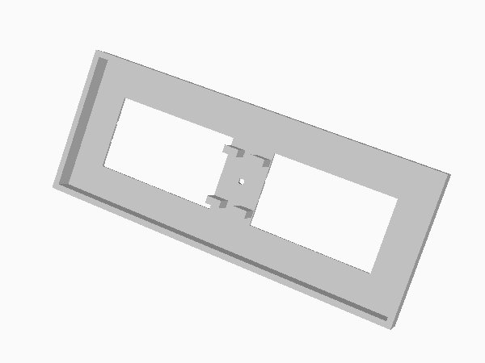
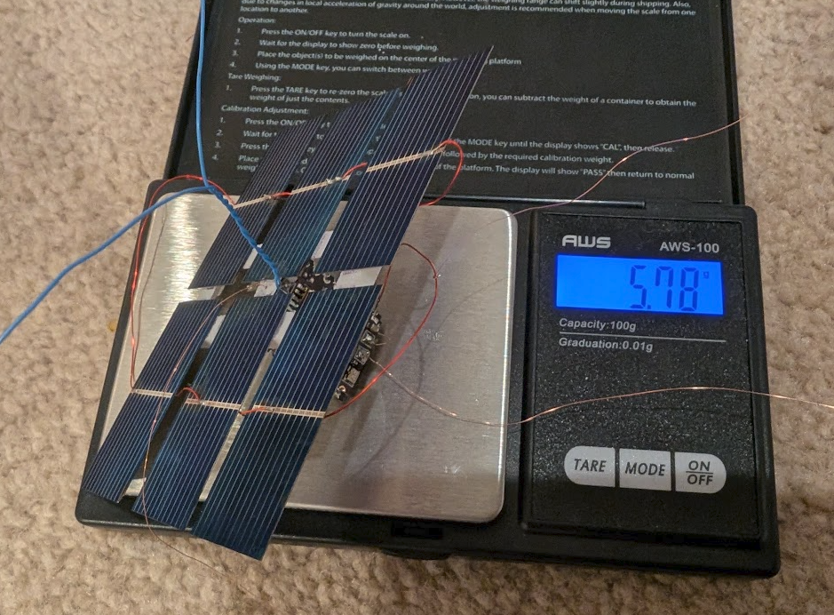

# Solar Cell Frame

This lightweight (~0.6 g), 3D-printable frame is 
designed to mount Vagabond1 transmitters to six 52×19 mm or 39×19 mm 
solar cells.

Attach the solar cells to the top of the frame using an adhesive such as 
B-7000. Feed the HF antenna through the hole in the center of the frame, 
then mount the PCB vertically on the underside of the frame, positioning 
it so that the GPS antenna protrudes above the solar cells.

Secure the PCB and HF antenna in place with a few drops of UV resin.

&nbsp;

